# Live Translate

**Live translation of a church service to people's phones. Free, and it all runs on your own PC: no subscriptions and no cloud.**

Someone speaks into the microphone, and a moment later everyone who needs it can read the service in their own language on their phone, or listen through earphones. Songs are skipped automatically. Listeners scan a QR code and don't need to install anything.

| The operator's screen | On a listener's phone |
|---|---|
| 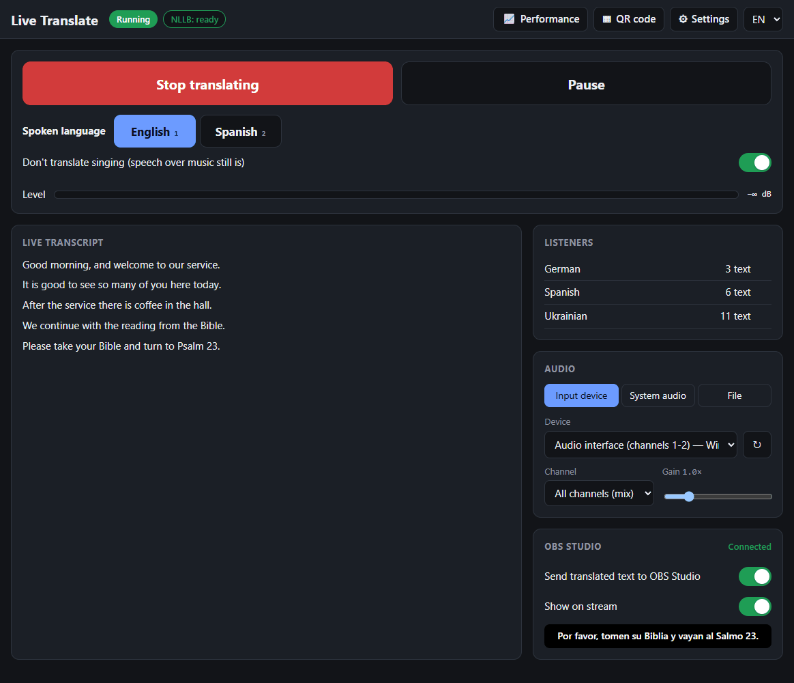 | 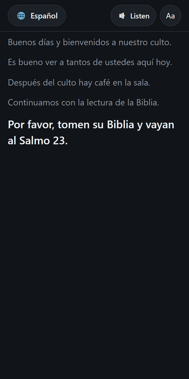 |

**Contents:** [What you need](#what-you-need) · [Installing](#installing) · [During a service](#during-a-service) · [For your listeners](#for-your-listeners) · [Settings](#settings) · [Moving your data](#moving-your-data) · [Updates](#updates) · [If something goes wrong](#if-something-goes-wrong) · [For developers](#for-developers)

## What you need

* **A Windows 10 or 11 PC.** It can be the PC that also runs your livestream. An NVIDIA graphics card is strongly recommended; without one it works, but more slowly.
* **About 8 GB of free disk space**, on any drive in the PC.
* **Internet once**, for the setup. After that it works without internet.
* **The sound of your service on that PC**: an audio interface or mixing desk works best, a microphone also works.
* **Wi-Fi for your listeners**: their phones have to be on the same network as the PC.

## Installing

### 1. Run the installer

Download `LiveTranslate-Setup-<version>.exe` from the [Releases](../../releases) page and run it. Windows asks for permission, because the installer opens a port so that phones can connect. Windows may also warn about an unknown publisher: choose **More info → Run anyway**.

### 2. Choose where the data goes

The first start asks where to keep the data. It takes about 7 GB, so you may want another drive. Press **Browse...** to pick a folder, then **Continue**.

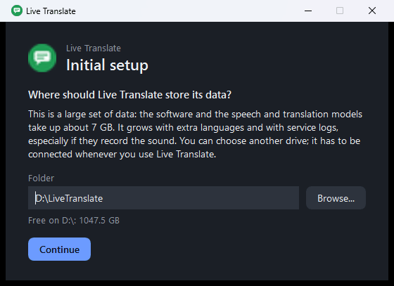

### 3. Wait for the software

Live Translate downloads what it needs. On a slower connection this can take a while, and you can use the PC in the meantime. If the connection drops, press **Try again**: what has arrived is kept.

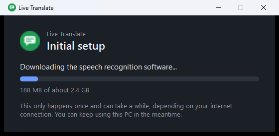

### 4. Answer a few questions

A short wizard then guides you through the rest. Anything that isn't essential has a **Skip** button, and you can change everything later.

| | |
|---|---|
| 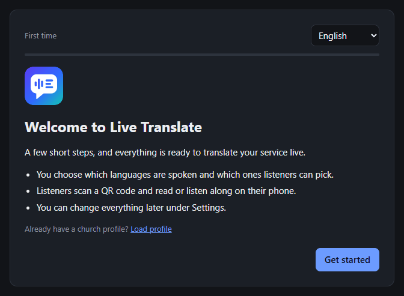 | **Welcome.** Pick the language for the app. If another church shared a *church profile* with you, you can load it here. |
| 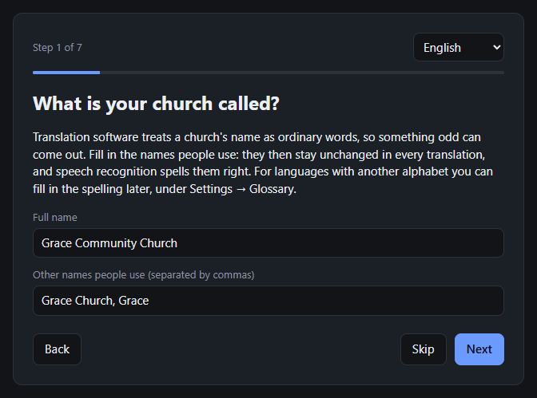 | **Your church's name.** Translation software treats a name as ordinary words, so something odd can come out. Enter the full name and any other names people use, separated by commas. They then stay unchanged in every translation. |
| 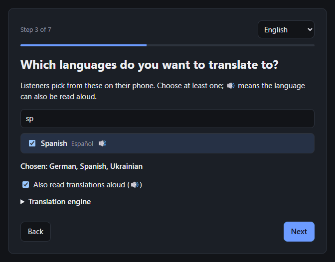 | **Languages.** First choose what is usually spoken, then which languages your listeners can pick. Use the search field to find one quickly. 🔊 means it can also be read aloud. |
| 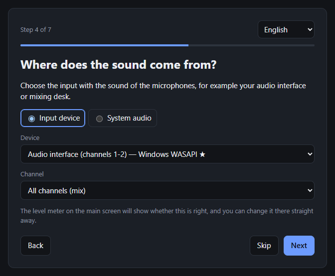 | **Sound.** Choose the input that carries your microphones. |
| 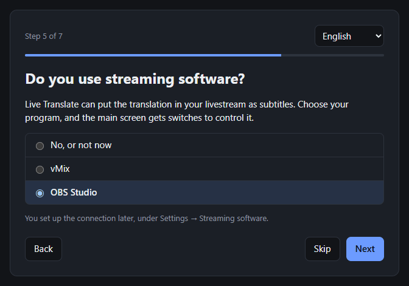 | **Streaming software.** Do you stream with vMix or OBS Studio? Choose it and the main screen gets switches to control the subtitles. You connect it later, and you can skip this if you don't stream. |
| 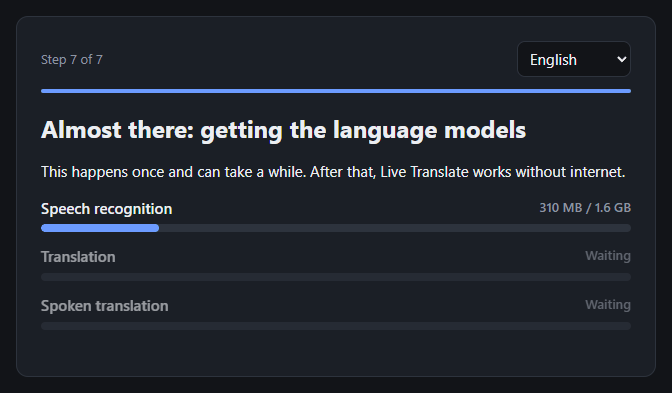 | **Getting everything ready.** The models for your choices are downloaded. This happens once. |
| 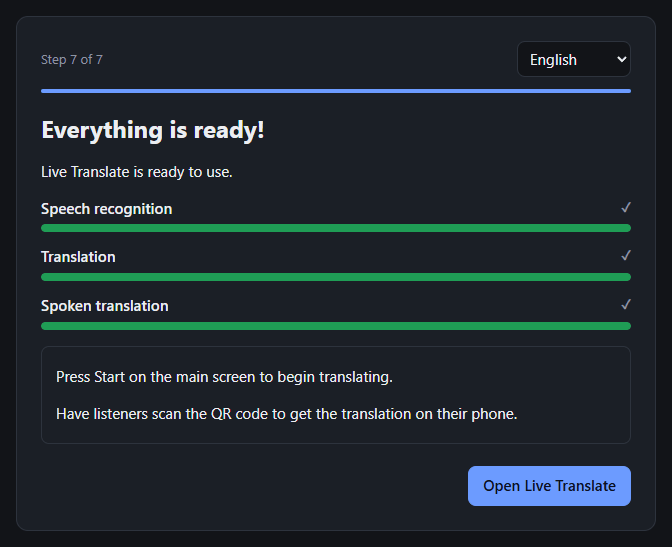 | **Done!** Press **Open Live Translate**. |

## During a service


1. **Press Start translating** (the big button). The first time after starting the PC, this takes a moment.
2. **Check the level meter**: it should move when someone speaks. If it doesn't, choose another input under **Audio**.
3. **Show the QR code** so people can join: press **QR code** at the top.
4. **That's it.** Songs are skipped by themselves, and speech over music is still translated.

Handy while it runs:

| To do this | Use this |
|---|---|
| Stop translating for a moment | **Pause**, or the space bar |
| Someone speaks another language (a testimony, say) | The language buttons, or keys `1`, `2`, `3` |
| Translate everything, also songs | The switch **Don't translate singing** |
| Show or hide the subtitles in your livestream | The switches in the vMix or OBS Studio panel |
| Note that something went wrong, to look at later | The **M** key (when the service log is on) |
| Open the app again after closing the window | Click the icon next to the clock |

**The icon next to the clock** shows how it's doing: grey is stopped, blue is loading, green is translating, orange is paused or another language. Closing the window keeps the app running; to really close it, right-click the icon and choose **Exit**.

## For your listeners

Show this QR code on a screen, or print it:

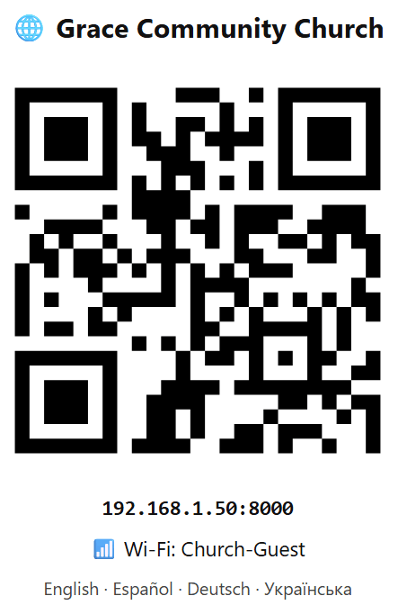

Listeners then:

1. **Connect to the Wi-Fi** shown under the code.
2. **Scan the code** with their phone's camera.
3. **Tap their language.** That's all: the translation appears as it is spoken.

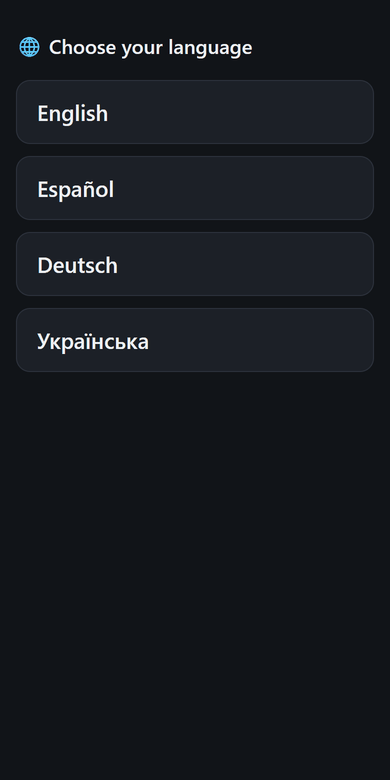 

Tap **Listen** to hear the translation through earphones; it keeps playing with the screen off. **Aa** changes the text size.

## Settings

Everything you change is saved by itself, and **Saved ✓** appears at the top. Typed text is saved when you leave the field or press Enter.

Press **Settings** at the top of the main screen. These are the ones you are most likely to use.

### Church: name, profile and song detection

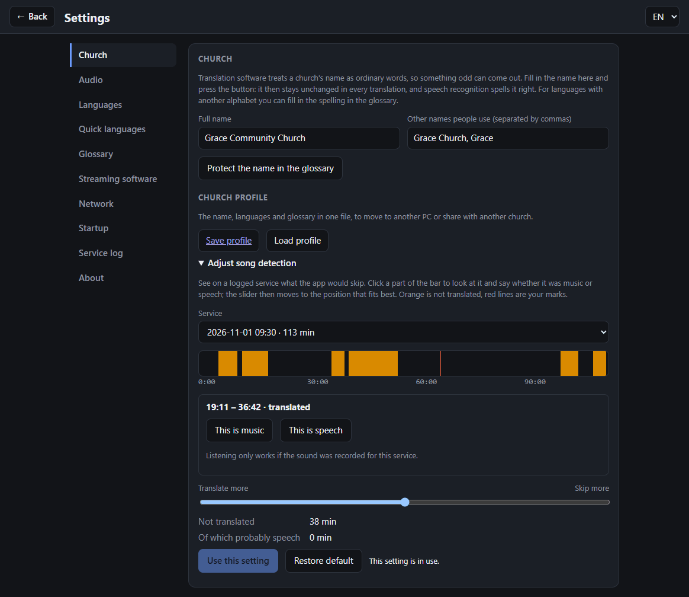

* **Name**: the names that must not be translated. Press the button after changing them.
* **Church profile**: puts the name, languages, glossary and [training](#training-teach-it-your-churchs-songs) in one file, to move to another PC or share with another church. No PINs or server details go in it.
* **Adjust song detection**: if songs get translated, or speech gets skipped, this lets you fix it. Turn on the service log for one service first. You then see that service as a bar, with what was skipped in orange. Move the slider, or click part of the bar and say whether it was music or speech, and the slider moves to what fits best.

### Training: teach it your church's songs

Live Translate can learn the sound of your own church, so it translates more of what is said and less of what is sung. It also misses less when someone talks over the band.

1. Under **Add services**, paste YouTube links or press **Choose files…**, one per line if you type them. With the link of a channel or playlist you tick the services from a list.
2. Press **Start training**. It takes a few minutes per service. You can stop and carry on later, and add more services at any time.
3. The app tests what it learned on services it hasn't seen, and only uses it if it works at least as well as the standard detection. You see the numbers on the same page, and **Use standard detection** takes you back.

You need at least two services, and more is better. You don't have to mark anything: the app finds the clear stretches of song and speech by itself and leaves the rest out. Recordings aren't kept, only a small summary of the sound in the `training` folder of the data folder. Use recordings of your own church only.

Training can't run during a service. If translating starts, training stops by itself and carries on from there when you start it again. While a trained model is in use, the song detection slider under **Church** isn't used.

### Languages

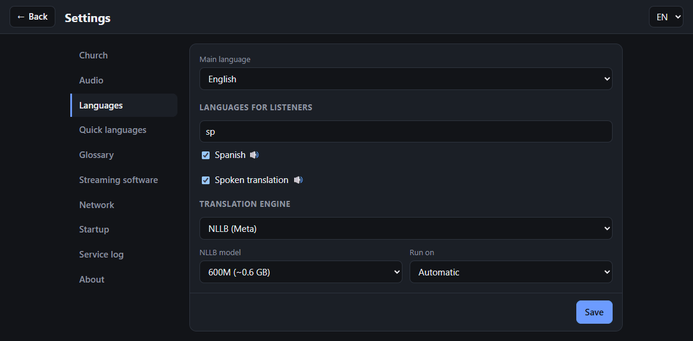

Choose the main language and the languages listeners can pick. Under **Quick languages** you choose which languages get a button on the main screen.

**No explicit language in translations** (on by default) keeps swear words out. Translation engines sometimes swear where the speaker didn't: "Ik was verdomme gek" came out as "I was fucking crazy". NLLB is kept from writing those words at all; with either engine they are also filtered out afterwards. Words with a normal or Bible meaning, such as *hell* or *damned*, stay. Covered: English, Dutch, German, French, Spanish, Portuguese, Italian, Polish, Russian and Ukrainian.

### Glossary: words that must come out right

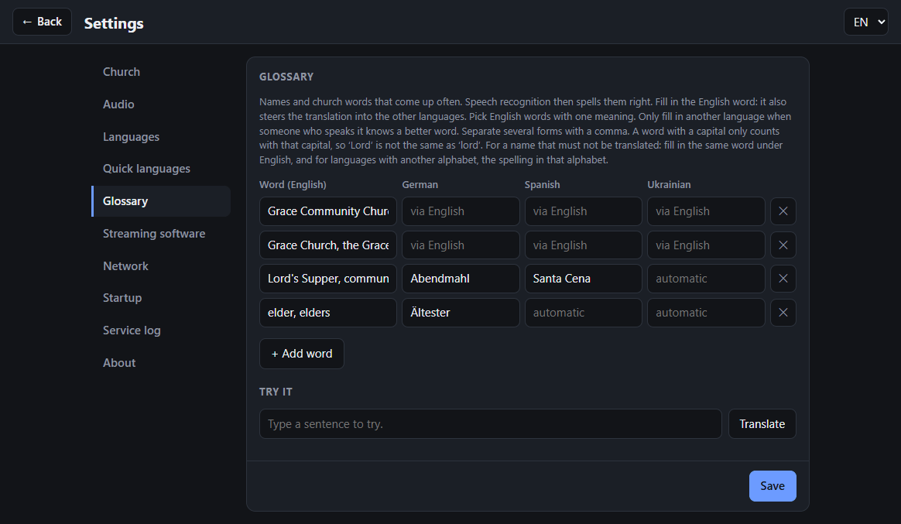

Some church words get translated oddly. Add them here with their English word; that also steers the translation into the other languages, so you don't need to know those. Only fill in another language when someone who speaks it knows a better word. **Try it** shows how a sentence comes out.

### Streaming software: subtitles in your livestream

Live Translate can put the translation in your livestream as subtitles, in **vMix** and in **OBS Studio**, even in both at once. At the top you choose which one gets switches on the main screen. Each program has its own tab with its own settings, including which language it shows.

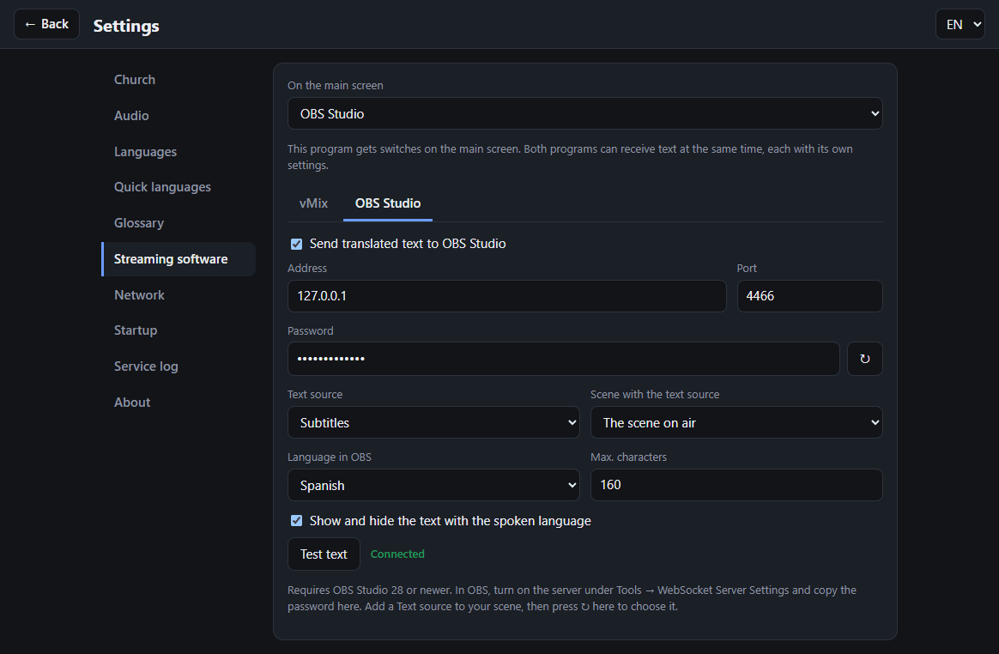

**OBS Studio** (version 28 or newer):

1. In OBS, open **Tools → WebSocket Server Settings**, tick **Enable WebSocket server**, and copy the password.
2. Add a **Text** source to your scene, and place and style it however you like. Leave its text empty.
3. In Live Translate, fill in the password and press **↻**. Choose your text source, tick **Send translated text to OBS Studio**, and press **Test text** to see it arrive.

**Show on stream** is the same as the source's eye in OBS. Live Translate uses the scene that is on air; if your text source lives in one fixed scene, choose that scene.

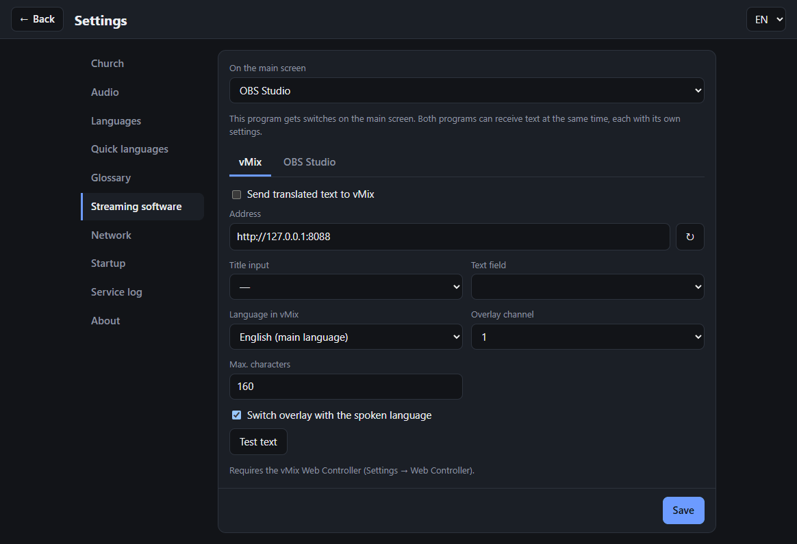

**vMix:**

1. In vMix, turn on **Settings → Web Controller** (port 8088).
2. Add a Title input.
3. In Live Translate, press **↻**, then choose the title input and its text field. Tick **Send translated text to vMix**, and press **Test text**.

### The other tabs

* **Audio**: the sound input, its volume, and the speech recognition model. A smaller model helps if your livestream starts stuttering.
* **Network**: the Wi-Fi name shown with the QR code, and a PIN if you want to control the app from a tablet. [Listening over the internet](#listening-over-the-internet-5g) is also set up here.
* **Startup**: start with Windows, and start translating by itself. For a PC that starts entirely by itself, also turn on automatic sign-in in Windows.
* **Service log**: keeps what was said and heard per service, on this PC only, to improve the settings with. It's off by default and can contain personal things such as prayers, so ask your church leadership first. Logs older than 30 days are removed.

### About

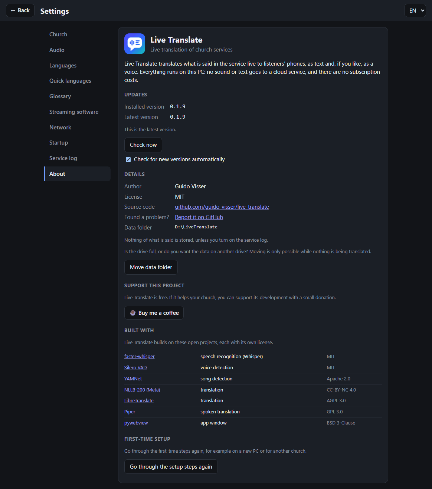

The version, updates, where your data is, and the option to go through the first-time steps again. Live Translate is free; if it helps your church, you can also find a donation button here.

## Moving your data

Is the drive filling up? Under **Settings → About**, press **Move data folder** while nothing is being translated. Live Translate closes, asks where the data should go, and starts again by itself.

Everything is copied first, and the old folder is only removed once it all works. If anything goes wrong, nothing has changed and the app keeps using the old folder. No internet is needed, unless you use the LibreTranslate engine: that part is set up again the next time it starts.

## Closing the window

When you close the window with the cross, Live Translate asks what you want:

* **Keep running in the tray** only closes the window. Translation carries on, and you can open the window again with the icon next to the clock.
* **Stop and exit** turns Live Translate off: translating stops, and listeners lose their connection.

Tick **Remember my choice** to stop being asked. You can change it again under **Settings → Startup**.

## Updates

When there's a new version, the main screen shows a bar with **Update now**. Nothing installs by itself, and updating only works while nothing is being translated. Windows asks for permission, and the app starts again afterwards. You can also check by hand under **Settings → About**.

**Do this well before a service**, because the first start after an update takes about a minute.

## Uninstalling

Remove Live Translate through **Windows Settings → Apps → Installed apps**. Your data normally stays on the PC, so that a new installation carries on where you left off.

To remove that as well, tick **Also remove all data** when the uninstaller asks. It shows which folders it will delete. **This throws away all of your settings, corrections and church profiles**, along with the service logs and downloaded models, and it can't be undone. A church profile you saved as a file elsewhere stays where you put it. Live Translate closes by itself first.

## If something goes wrong

| What you see | What to do |
|---|---|
| Phones can't connect | Check that they're on the same Wi-Fi as the PC. Some guest networks keep devices apart; then use another network, or [listening over the internet](#listening-over-the-internet-5g). |
| The level meter doesn't move | Choose another input and channel under **Audio** on the main screen. |
| The livestream stutters | Choose a smaller model under **Settings → Audio**, and see [below](#if-vmixobs-starts-dropping-frames). |
| Text appears during songs, or speech is skipped | Use **Settings → Church → Adjust song detection**. |
| A name or word comes out wrong | Add it under **Settings → Glossary**. |
| Translation lags behind | Open **Performance** at the top. A slower PC may need a smaller model. |
| The text on a phone stops when the screen locks | Reading needs the screen on. **Listen** does keep playing. |
| Starting takes minutes, with "Live Translate is starting" on screen | Windows is probably busy updating, often right after the PC wakes up. Wait for it; clicking again doesn't help. Set Windows Update's **active hours** to cover your services, and start the app well before one. |
| The tray icon turns red | The pages stopped working. Live Translate starts itself again to fix it, and carries on translating. If it stays red, close it from the tray and start it again. |
| The setup says the data folder can't be reached | Connect the drive it's on, and start Live Translate again. |
| Still stuck | [Report it on GitHub](../../issues), and include `livetranslate.log` from the data folder. It's shown under **Settings → About**. |

---

# For developers

Everything below is for people who want to change the app, or set up the more advanced parts.

```
Mixer / mic / livestream audio ──► Whisper speech recognition (GPU) ──► NLLB or LibreTranslate
                                                                             │
           phones on the church Wi-Fi ◄── web page with live subtitles ◄─────┤
                                      ◄── optional spoken translation (Piper) ◄┘
```

It runs on Windows, macOS and Linux; the installer, the window and start with Windows are Windows-only. **From source:** install [uv](https://docs.astral.sh/uv/getting-started/installation/), then run `start.cmd` (Windows) or `./start.sh` (macOS/Linux).

The installer adds a Windows Firewall rule for TCP port 8000 so phones can connect, and installs the current Microsoft Visual C++ runtime when the PC has one older than 14.40 (older ones make the speech and voice libraries crash). If speech recognition or a voice can't load, the operator page says why instead of the app closing; crashes inside native libraries are written to `crash.log` in the data folder.

**First start on Windows.** `LiveTranslate.vbs` starts `LiveTranslateSetup.ps1` when the Python environment for this version is missing. That window runs before Python exists on the PC, so it uses PowerShell with WPF; if it can't run, `LiveTranslate.cmd` does the same work in a console. Moving the data folder is done there too (`-Move`), because the app runs from that folder: it copies the data, sets up the software again from the copied download cache, and only then switches over and removes the old copy.

**To publish an update**, raise `version` in `pyproject.toml` and push a `v<version>` tag: the workflow builds the installer and attaches it to the release. The launcher only sets up its environment again when the version changes, so every release needs a new version.

### Spoken language and streaming software

When the spoken language is not the main language (for example a testimony in another language):

* Phones get the original speech in that language and translations in the other languages.
* With *Send translated text to vMix* or *to OBS Studio* on, the main-language translation (or another chosen language) goes to the chosen title or text source as rolling subtitles (previous + current sentence, limited by *Max. characters*). Each program can show its own language; they run independently.
* With *Switch overlay with the spoken language* on, switching away from the main language clears the title and brings the overlay in; switching back takes it out. The *Overlay* switch on the main screen works at any time.

vMix is reached over its Web API (HTTP). OBS is reached over its built-in WebSocket server (protocol 5, OBS 28+), with `integrations/obs.py` keeping one connection open and reconnecting when OBS comes back. In OBS an overlay is the scene item's visibility, in the chosen scene or else the current program scene. The two share their subtitle logic in `integrations/subtitles.py`. If OBS is closed during a service, the operator page says so and translation to phones carries on.

### If vMix/OBS starts dropping frames

Speech recognition shares the GPU. When the GPU is short: under **Settings → Audio** pick a smaller speech-recognition **model** (`medium` or `small`) or set **Run on** to *CPU*. When the processor is short: make sure NLLB runs on the GPU (**Settings → Languages**). Changes apply immediately. The *Performance* panel shows GPU load, memory and the delay.

| Model | GPU memory (approx.) | Quality |
|---|---|---|
| large-v3-turbo (default) | ~1.5 GB | very good, fast |
| large-v3 | ~3 GB | best, slower |
| medium | ~1 GB | good |
| small | ~0.5 GB | fair; OK on CPU |

### Listening over the internet (5G)

When the church Wi-Fi is unreliable, phones can also listen over their own mobile internet. Live Translate then keeps an SSH tunnel open from this PC to a server of your own (for example a VPS with Plesk), which serves a public HTTPS address and passes listeners through the tunnel. The church router needs no changes, and the operator page can never be reached this way: the tunnel ends on a separate port on this PC that only serves the listener page.

Set it up under **Settings → Network → Listening over the internet**. Fill in the public address, the server, the SSH user and the port on the server. *Server setup* shows the nginx lines to paste into the subdomain's *Additional nginx directives* in Plesk, and this PC's key for `~/.ssh/authorized_keys`, limited to this one tunnel. The QR code then shows the public address, which works on the Wi-Fi as well. The PC needs a reliable internet connection during the service; each listener uses about 50 kbit/s of its upload. The tunnel reconnects by itself, and the settings page shows whether the public address actually reaches this PC.

## How it works

* **Speech recognition**: [faster-whisper](https://github.com/SYSTRAN/faster-whisper). The audio is re-recognized every second; words two passes agree on are committed (LocalAgreement), and a sentence is released at punctuation or when the speaker pauses. Silero VAD skips silence and instrumental music, and captions Whisper writes itself ("ZINGEN EN MUZIEK", "[muziek]", "♪") are dropped. The typical delay is 1–3 s after the end of a sentence.
* **Songs**: [YAMNet](https://github.com/tensorflow/models/tree/master/research/audioset/yamnet) (Apache 2.0, included as `stt/yamnet.onnx`) scores the last 2 seconds about once a second. While that is music without speech and the voice detector doesn't hear a steady voice, recognition pauses and nothing is translated. When unsure, it translates. Speech over music mostly gets through, less so as the music gets louder than the voice. The switch on the main screen turns this off, and the header shows when it is active.
* **Keeping the processor free for the livestream**: the sound detection and the voices run on the GPU through DirectML (about 0.1 GB per sound detection, 0.2–0.4 GB per voice in use; they fall back to the CPU with 2 threads). The app runs at below-normal priority, so a stream on the same PC goes first. Use NLLB on the GPU: on the CPU each sentence takes 3–4 CPU-seconds per language.
* **Translation**, two engines you can switch between on the operator page (only languages someone is actually reading or listening to are translated):
  * **LibreTranslate**: a private [LibreTranslate](https://github.com/LibreTranslate/LibreTranslate) the app installs and runs on `127.0.0.1:5001` on the CPU. It goes through English, which is one step more for most languages. You can also use an existing LibreTranslate server by putting its URL in `libretranslate_url` in the settings file.
  * **NLLB** ([Meta NLLB-200](https://huggingface.co/facebook/nllb-200-distilled-600M), run with CTranslate2): translates directly between 200 languages and is much better for Ukrainian. *600M* (~0.6 GB, ~0.6 s per sentence on the CPU) or *1.3B* (~1.4 GB, ~1 s, slightly better). It runs on the GPU when there is one (~0.6 GB). The model downloads the first time you select it. License: CC-BY-NC 4.0 (non-commercial use).
* **Glossary**: Whisper gets the words as *hotwords*. For a language without its own translation, the English word goes into the spoken sentence (Dutch "Welkom in de church") and the engine translates it from there, in the right grammatical case. It is a strong hint, not a guarantee, so pick English words with one meaning ("donations", not "offering", which can mean a sacrifice). A translation filled in for a language is used as is: NLLB gets it in the sentence; LibreTranslate would lose another alphabet on its way through English, so there the word becomes a `[1]` placeholder and is put back afterwards, not declined. A name (English word the same as the spoken word) is a placeholder with both engines. If a placeholder gets lost, the sentence is translated without the glossary. None of this slows translation down: each sentence is still translated once per language.
* **Speech**: [Piper](https://github.com/OHF-Voice/piper1-gpl) voices (downloaded on demand), streamed per language as a continuous MP3 stream, only while someone listens.
* **Privacy**: nothing is recorded or stored unless you turn on the service log. Transcripts otherwise exist only in memory; only settings are saved (`settings.json` in the standard folder).
* **Service log** (off by default, **Settings → Service log**): one folder per service in `service-logs` in the data folder, with `events.jsonl` (sentences, translations, Whisper's confidence, what the sound detection heard, moments marked with **M** on the main screen) and optionally `audio.flac`. It stays on the PC and folders older than 30 days are removed. It can contain personal things such as prayers, so ask your church leadership first. The header shows when it is on.
* **Admin protection**: the operator page only works on the PC itself. To control it from a tablet, set an admin PIN and open `http://<pc-address>:8000/admin?pin=<PIN>`.

Data (models, logs, the Python and LibreTranslate environments) lives in the folder picked at the first start (`data-location.txt` in the standard folder says which), by default `%LOCALAPPDATA%\LiveTranslate` (Windows), `~/Library/Application Support/LiveTranslate` (macOS) or `~/.local/share/LiveTranslate` (Linux). With a picked folder, LibreTranslate's models and the Hugging Face cache go there too (`XDG_*` and `HF_HOME`); without one they stay in the home folder, so older installs don't download everything again. Settings always stay in the standard folder.

## Known limitations

* **Ukrainian with LibreTranslate**: its English → Ukrainian model is weak and sometimes produces Bible-like phrases that weren't said. Use the **NLLB** engine for Ukrainian.
* **Phones and sleeping screens**: text needs the screen on. The page tries to keep it awake, but browsers only fully allow that over HTTPS. Spoken audio does keep playing with the screen off.
* The first sentence after pressing Start can take longer while the model loads.

## Development

```bash
uv sync
uv run pytest
uv run python -m livetranslate --port 8000   # --no-tray on a headless server
```

Build the Windows installer (needs [Inno Setup 6](https://jrsoftware.org/isdl.php)):

```powershell
powershell -ExecutionPolicy Bypass -File packaging\windows\build.ps1
```

The GitHub Actions workflow builds the installer on every push and attaches it to a release when a `v*` tag is pushed.
